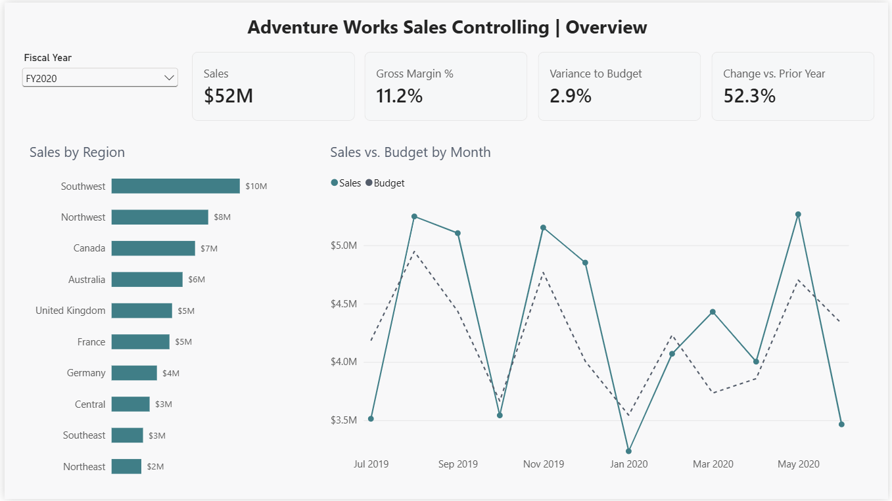
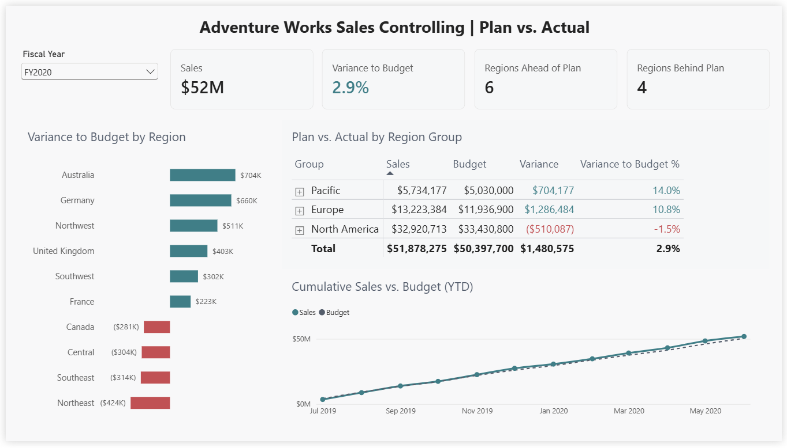
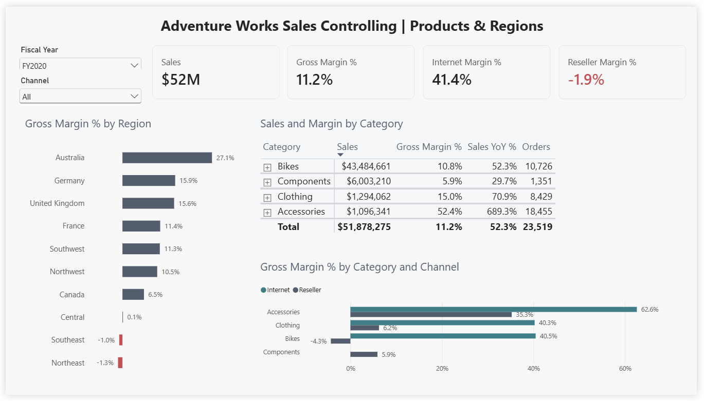

# Sales Controlling Dashboard (Plan vs. Actual) in Power BI

A three page controlling report for a fictional bicycle company that compares actual sales with budget, tracks the year to date result against plan, and explains where margin is won and lost. Built in Power BI Desktop and saved in the Power BI Project (PBIP) format, so the data model and every DAX measure can be read directly on GitHub.

## Business questions

1. Are we ahead of or behind budget, in total and by region?
2. Is the year to date result on track to reach the annual plan?
3. How do sales and margin develop compared with the prior year?
4. Which product categories and sales channels drive margin?

Full requirements: [docs/requirements.md](docs/requirements.md)

## Key findings (fiscal year 2020, July 2019 to June 2020)

* **Sales beat plan by 2.9%.** Sales of $51.9M against a budget of $50.4M, a positive variance of $1.48M, with sales tracking slightly above plan for the whole year.
* **The result is broad based but not universal.** 6 of 10 regions finished ahead of plan. Australia led with +$704K (+14%), while Northeast missed by $424K (-15%). North America as a group finished 1.5% below plan; Europe and Pacific carried the overall result.
* **The reseller channel loses money.** Internet sales earn a 41.4% gross margin, while reseller sales run at -1.9%, even though resellers bring in more than twice the revenue ($36.2M vs. $15.6M).
* **Reseller bikes are the root cause.** Bikes sold through resellers have a margin of -4.3% (vs. 40.5% online), and bikes make up about 80% of reseller sales. Reseller pricing for bikes is the first lever to review.
* **Accessories grew 689%** year over year, from a small base ($139K to $1.1M), at the highest margin of any category (52.4%).

## Report pages

| Page | What it answers |
| --- | --- |
| Overview | Headline KPIs, sales vs. budget by month, sales by region |
| Plan vs. Actual | Variance to budget by region, regions ahead and behind plan, cumulative sales vs. budget (YTD) |
| Products & Regions | Margin by region, sales and margin by category, margin by category and channel |

### Overview


### Plan vs. Actual


### Products & Regions


## Data model

Star schema with two fact tables, **Sales** (121,253 order lines) and **Budget** (240 monthly plans by region), sharing the **Date** and **Territory** dimensions, plus **Product**, **Reseller** and **Sales Order** dimensions. The Date table is marked as a date table, and automatic date tables are turned off.

## DAX highlights

All measures live in a dedicated `_Measures` table and carry a description. A few examples:

**Variance that only compares months with a budget.** FY2018 has sales but no budget. A simple subtraction would count all FY2018 sales as "over budget" in the total. This version iterates over months and skips months without a plan:

```dax
Variance =
SUMX (
    VALUES ( 'Date'[MonthKey] ),
    IF (
        NOT ISBLANK ( [Budget Amount] ),
        [Sales Amount] - [Budget Amount]
    )
)
```

**Year to date with a fiscal year ending 30 June:**

```dax
Sales YTD = TOTALYTD ( [Sales Amount], 'Date'[Date], "06-30" )
```

**Counting regions ahead of plan:**

```dax
Regions Ahead of Plan =
COUNTROWS (
    FILTER (
        VALUES ( Territory[Region] ),
        NOT ISBLANK ( [Variance] ) && [Variance] >= 0
    )
)
```

**Channel margin that ignores the channel slicer:**

```dax
Reseller Margin % =
CALCULATE ( [Gross Margin %], 'Sales Order'[Channel] = "Reseller" )
```

Conditional formatting (teal for ahead of plan, red for behind) is driven by measures, so the colors stay consistent across every visual.

## Skills shown

* **Power Query:** data typing, column cleanup, a custom date key to join the budget to the calendar
* **Data modeling:** star schema with two fact tables, relationships, marked date table
* **DAX:** CALCULATE, SUMX, FILTER, DIVIDE, TOTALYTD with fiscal year end, SAMEPERIODLASTYEAR, measure driven conditional formatting
* **Report design:** consistent grid layout, plan vs. actual conventions (solid actual, dashed plan)
* **Requirements engineering:** stakeholders, business questions, KPI definitions
* **Version control:** Power BI Project (PBIP) format with Git and GitHub

## How to open the report

1. Install [Power BI Desktop](https://aka.ms/pbidesktopstore) (Windows).
2. Clone this repository.
3. Download [AdventureWorks Sales.xlsx](https://github.com/microsoft/powerbi-desktop-samples/tree/main/AdventureWorks%20Sales%20Sample) and save it in the `data` folder.
4. Open `Controlling Dashboard.pbip`. If Power BI cannot find the file, go to Transform data > Data source settings and point it to your `data` folder. Then click Refresh.

## Data sources

* **Sales data:** Microsoft Power BI Desktop samples (AdventureWorks), not included in this repository.
* **Budget data:** `data/Budget.csv`, created for this project from prior year actuals by month and region, with a planned variance per region.
* **Report theme:** based on the "Dynamics 365 Business Central" theme from the Power BI Themes Gallery, adjusted for this report.
